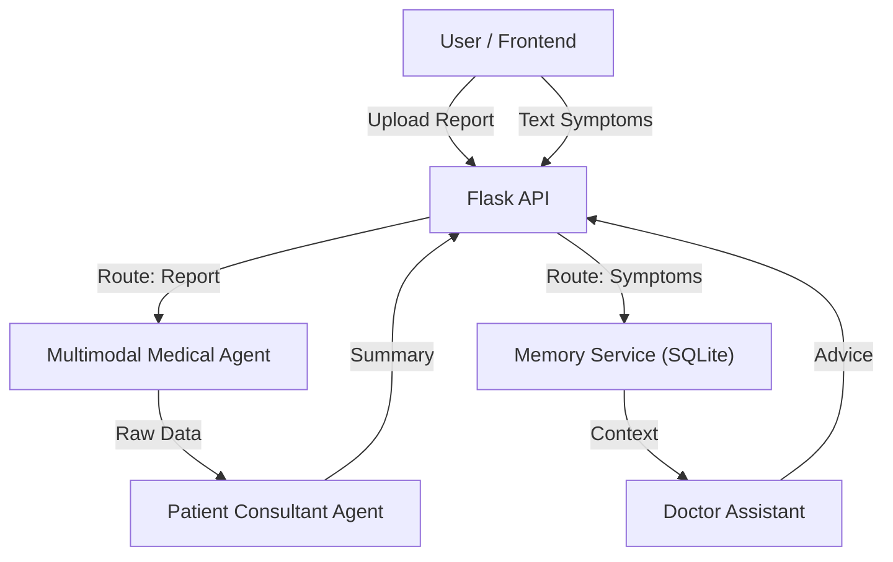
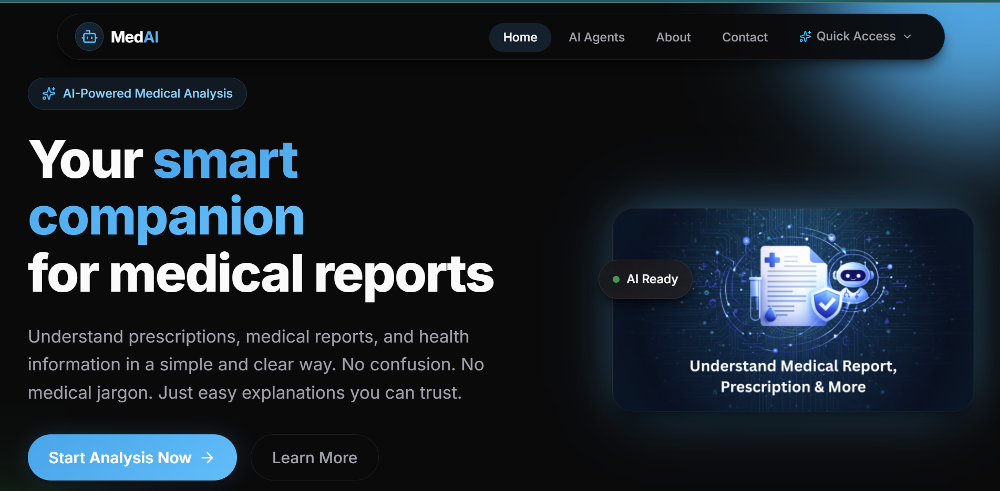
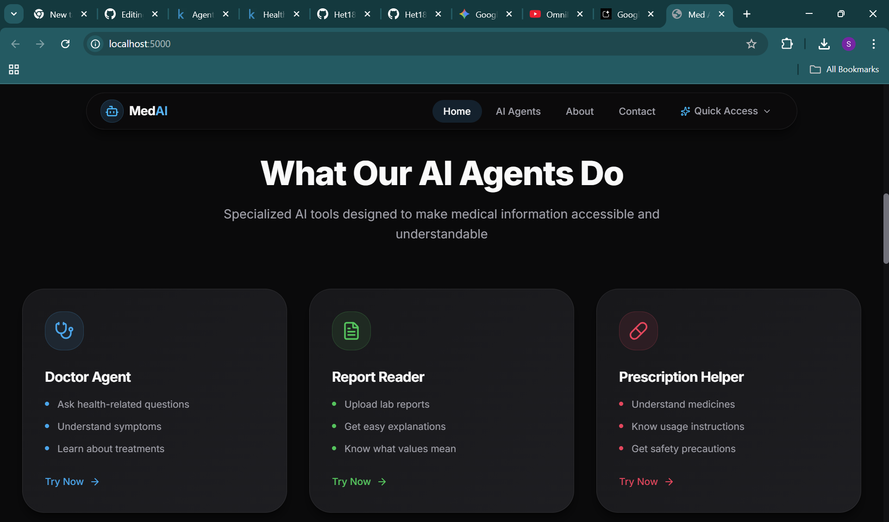
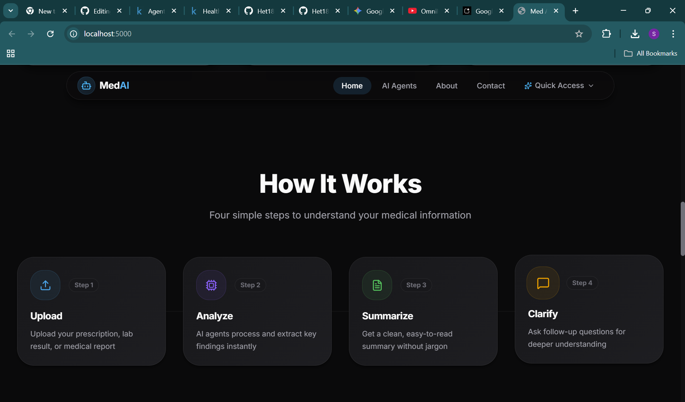
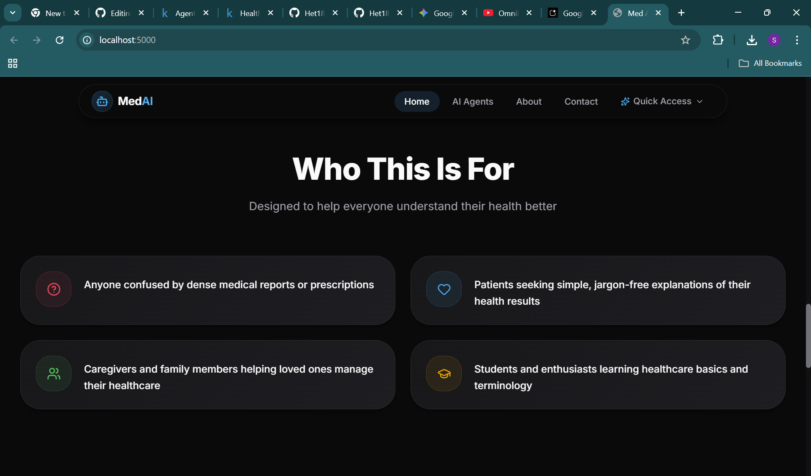
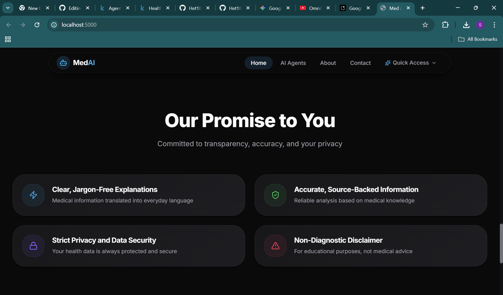
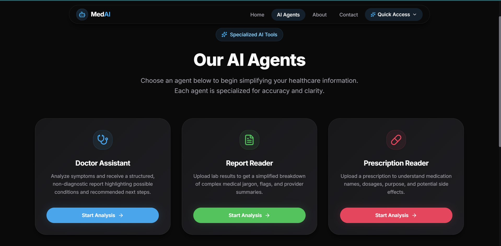

# **🏥 AI-Powered Healthcare Report & Prescription Analyzer**

**Kaggle Agents Intensive Capstone Project Submission**

* **Track:** Agents for Good  
* **Goal:** Democratizing access to medical record understanding through autonomous multi-agent systems.

---

## **📖 Overview**

The **Healthcare Report & Prescription Analyzer** is an intelligent multi-agent system designed to help patients understand complex medical documents. By leveraging **Google's Gemini 2.0 and 2.5 models**, the system can analyze diagnostic reports, decipher handwritten prescriptions, and provide preliminary symptom triage—all explained in simple, patient-friendly language.

Unlike standard chatbots, this project uses a **Multi-Agent Architecture** where specialized agents (Doctor, Consultant, Reader) collaborate to process multimodal inputs (text, images, PDFs) and maintain long-term memory of patient history.

---

## **👥 Team Members**

* **Anavi Gupta** — [GitHub Profile](https://github.com/YOUR_GITHUB_USERNAME)
* **Aniket** — [GitHub Profile](https://github.com/YOUR_GITHUB_USERNAME)
* **Anshdeep Kaur** — [GitHub Profile](https://github.com/YOUR_GITHUB_USERNAME)

---

## **✨ Key Features**

* **📄 Smart Report Analysis:** Upload generic blood work or diagnostic reports (PDF/Images). The `MultimodalMedicalAgent` extracts strict structured data (lab results, flags) and provides a "Consultant's Summary" explaining what the numbers mean.  
* **💊 Prescription Deciphering:** Upload a photo of a handwritten prescription. The `PrescriptionReaderAgent` extracts medicine names, dosages, and instructions using advanced vision capabilities.  
* **🩺 Symptom Triage:** Chat with the `DoctorAssistant` about your symptoms. It uses a Chain-of-Thought approach to provide safety-first guidance, immediate actions, and specialist recommendations.  
* **🧠 Long-Term Memory:** Built on SQLite (`memory_service.py`), the system remembers past sessions and user context, allowing for personalized interactions across different consultations.

---

## **🤖 Agent Architecture**

This project implements a modular multi-agent system powered by the **Google GenAI SDK**:

1. **Multimodal Medical Agent (`gemini-2.0-flash`):**  
   * *Role:* Extracts entities (patient info, lab results) from unstructured files.  
   * *Tools:* Custom `SmartLoader` (`document_loader.py`) for document processing.  
   * *Output:* Strict JSON schema for medical records.  
2. **Patient Consultant Agent:**  
   * *Role:* "The Translator." Takes raw medical data and generates a human-readable, empathetic summary in Markdown/HTML.  
3. **Prescription Reader Agent:**  
   * *Role:* OCR and analysis specialist for handwritten pharmacy notes.  
4. **Doctor Assistant (`gemini-2.5-flash`):**  
   * *Role:* Triage agent.  
   * *Behavior:* Enforces strict safety protocols (disclaimers first) and outputs structured advice (Immediate Actions, Specialist Referral).

### **System Flow**



---

## **🛠️ Tech Stack**

* **Frontend:** React 19, Vite, Tailwind CSS, Lucide Icons, Framer Motion  
* **Backend:** Python 3.11+, Flask 3.x, Flask-CORS  
* **AI Models:** Google Gemini 2.0 Flash, Gemini 2.5 Flash (`google-genai` SDK)  
* **Database:** SQLite (SQLAlchemy) for Session & Memory management  
* **Validation:** Pydantic 2.x for strict JSON output parsing

---

## **🚀 Getting Started**

### **Prerequisites**

* Node.js (v18+) & npm  
* Python 3.11+  
* Google Gemini API Key (obtain from [Google AI Studio](https://aistudio.google.com/))

---

### **🔐 Environment Setup (`.env`)**

The application requires environment variables in `Backend/.env` to authenticate with Gemini models and secure Flask sessions.

1. Navigate to the `Backend` folder:
   ```bash
   cd Backend
   ```

2. Copy the sample environment file `.env.example` to create your `.env` file:
   ```bash
   # On Windows (PowerShell):
   Copy-Item .env.example .env

   # On Linux / macOS:
   cp .env.example .env
   ```

3. Open `Backend/.env` in your code editor and populate your credentials:
   ```env
   # Replace with your actual Gemini API Key from https://aistudio.google.com/
   GOOGLE_API_KEY=AIzaSy...

   # Replace with a secret key for Flask sessions
   FLASK_SECRET_KEY=your_custom_secret_key_here
   ```

> ⚠️ **Security Notice:** Never commit your `.env` file or API keys to GitHub. `.env` is listed in `.gitignore` to prevent accidental credential leaks.

---

### **1. Backend Setup**

```bash
cd Backend

# Create a virtual environment
python -m venv .venv

# Activate the virtual environment
# Windows (PowerShell):
.\.venv\Scripts\Activate.ps1
# Linux/macOS:
source .venv/bin/activate

# Install Python dependencies
pip install -r requirements.txt

# Run the Flask Server
python app.py
```
*The backend server will run on `http://localhost:5001`*

---

### **2. Frontend Setup**

```bash
cd Frontend

# Install Node dependencies
npm install

# Start the Vite Development Server
npm run dev
```
*The frontend web application will start on `http://localhost:5173`*

---

## **📸 Demo & Screenshots**

### **Features Showcase**
* **Analyze Medical Reports:** Upload medical diagnostic reports (PDF/Image). The agent extracts laboratory values, classifies document types, and flags abnormal metrics with clear explanations.
* **Decipher Prescriptions:** Upload a photo or scanned copy of a handwritten prescription. The vision model extracts drug names, forms, dosages, side effects, and warnings.
* **Symptom Triage Doctor Agent:** Chat with the `DoctorAssistant` about your symptoms. The agent checks past session memory, applies Chain-of-Thought reasoning, and suggests immediate actions along with specialist referrals.

| Landing & Overview | AI Doctor Assistant |
|---|---|
|  |  |

| Report Analyzer | Prescription Reader |
|---|---|
|  |  |

| Detailed Insights | Memory & History |
|---|---|
|  |  |

---

## **🏆 Capstone Implementation Details**

This project specifically addresses the **Agents for Good** track by utilizing:

* **Multi-Agent Orchestration:** Separation of concerns between extraction (Vision) and consultation (Reasoning).  
* **Tool Use:** `document_loader.py` acts as a document retrieval tool for the agents.  
* **Structured Output:** All agents utilize strict JSON schemas (via Pydantic) to guarantee reliable parsing and UI stability.  
* **Memory Integration:** `memory_service.py` captures context across interactions to provide consistent clinical history.

---

## **📬 Contact & Location**

* **Email:** [anshdeep0211@gmail.com](mailto:anshdeep0211@gmail.com)
* **Phone:** +91 9877526403
* **Institution:** University Institute of Engineering & Technology (UIET), Panjab University, Chandigarh, 160014, India

---

## **⚠️ Disclaimer**

*This project is an AI prototype for educational purposes only. It is not a substitute for professional medical advice, diagnosis, or treatment. Always seek the advice of your physician.*

*Built for the Google AI Agents Intensive 2025.*
